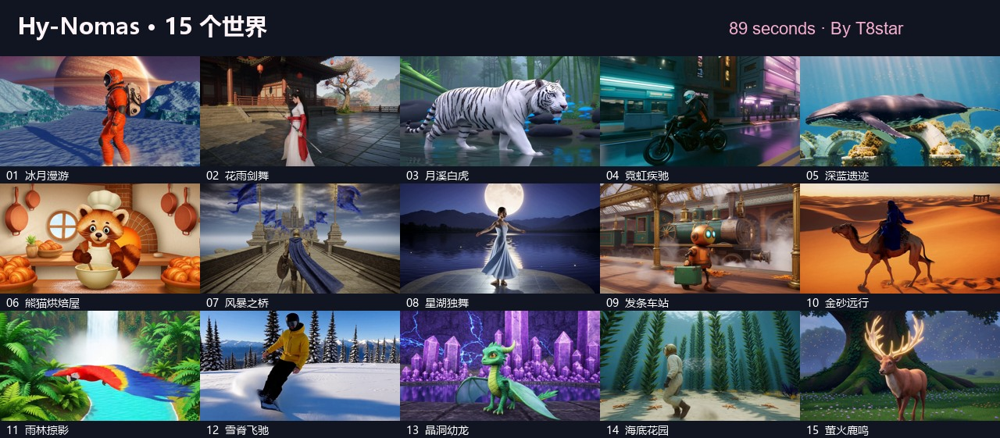

# Hy-Nomas T8 · By T8star

**简体中文** | [English](README.en.md)

在 ComfyUI 中原生运行 Hy-Nomas 视频世界模型：文字或图片起始、分段续接、相机控制与键盘交互。标准 KSampler 直接采样，模型与历史缓存由宿主管理。

[模型下载](https://huggingface.co/t8star/HY-Nomas-Comfy) · [89 秒实测视频](https://huggingface.co/t8star/HY-Nomas-Comfy/blob/main/samples/hy-nomas-15-worlds.mp4) · [工作流](workflows) · [Registry](https://registry.comfy.org/nodes/hy-nomas-t8)

[](https://huggingface.co/t8star/HY-Nomas-Comfy/blob/main/samples/hy-nomas-15-worlds.mp4)

## 安装

在 ComfyUI-Manager 搜索 **Hy-Nomas T8**（Publisher：`t8star`），安装后重启。Registry 版本通过审核前，可从 Git URL 安装：

```bash
cd ComfyUI/custom_nodes
git clone https://github.com/T8mars/Comfyui-HY-Nomas-T8.git
```

使用该 ComfyUI 的 Python 安装依赖：`python -m pip install -r Comfyui-HY-Nomas-T8/requirements.txt`。ComfyUI 与 PyTorch 由宿主提供；本包不自动替换 PyTorch。

**实测环境：** Windows、ComfyUI 0.42.1、Python 3.12.9、PyTorch 2.10.0+cu130、Triton Windows 3.6.0.post26。建议 NVIDIA **24GB 显存、64GB RAM**，模型约占 28GB 磁盘。首次加载建议至少 30GiB 可用 RAM。其他环境的兼容性与性能需实际验证。

Windows 启动 ComfyUI 前建议设置 `MIMALLOC_PURGE_DELAY=0` 与 `MIMALLOC_ARENA_EAGER_COMMIT=0`。完整内存说明、同版本宿主可选补丁及依赖说明见 [高级指南](docs/advanced.zh-CN.md)。

## 模型

| 文件 | 大小 | 放置目录 |
| --- | ---: | --- |
| `hy_nomas_distil_int8.safetensors` | 9.06 GB | `ComfyUI/models/diffusion_models/` |
| `hy_nomas_pixelumm_fp8.safetensors` | 9.13 GB | `ComfyUI/models/vae/` |
| `qwen_2.5_vl_7b_fp8_scaled.safetensors` | 9.38 GB | `ComfyUI/models/text_encoders/` |

从 [t8star/HY-Nomas-Comfy](https://huggingface.co/t8star/HY-Nomas-Comfy) 下载上述文件。已有同一权重可直接复用：在 `extra_model_paths.yaml` 配置外部模型目录，再在加载器中选择实际文件名；保留 `.safetensors` 扩展名即可使用改名文件。

## 开始生成

1. 将 `workflows/` 中的画布 JSON 拖入 ComfyUI。
2. 选择 DiT、Qwen 文本编码器（CLIP 类型 `qwen_image`）和 PixelUMM 解码器。
3. 编辑世界 JSON 中的场景与动作，点击运行。采样建议 **8 步、CFG 1、euler / simple**。

| 工作流 | 用途 |
| --- | --- |
| `T8 - Budgeted world.json` | CPU 历史预算与占用统计，建议从这里开始 |
| `Hy-Nomas world (per segment).json` | 标准 KSampler 分段生成与续接 |
| `Hy-Nomas world (one node).json` | 单节点串联世界生成 |
| `Hy-Nomas start from image.json` | 图片起始 |
| `Hy-Nomas camera control.json` | 相机轨迹与按键控制 |
| `Hy-Nomas drive (interactive).json` | 键盘交互生成 |

本包包含 **15 个原生节点、6 个画布工作流**。T8 增加 CPU KV 档案预算、占用统计、缓存清理，以及取消/失败后的状态回滚。默认 12GiB 档案预算只限制 CPU 历史，不代表总 RAM 或显存上限；长续接应留意占用并适时导出、重置。

## 本机实测

RTX 5090 Laptop 24GB / 64GB RAM，INT8 DiT、FP8 解码器与文本编码器：

| 场景 | 输出 | 整卡显存峰值 | 最低可用 RAM |
| --- | --- | ---: | ---: |
| 原生双段默认工作流 | 1280×704，10 秒 / 240 帧 | 17.53GiB | 8.15GiB |
| 15 个独立新场景 | 每段 1280×704，6 秒 / 144 帧 | 最高 16.28GiB | 最低 9.03GiB |

测试使用上述启动环境设置及 ComfyUI 0.42.1 缓存引用补丁。89 秒合集加入了片头、短转场、标题和后期配乐。结果为本机记录，不代表所有宿主配置。

## 来源与许可

基于 [PedroMarinhoDev/ComfyUI-Hy-Nomas](https://github.com/PedroMarinhoDev/ComfyUI-Hy-Nomas)，模型与算法来自 [Tencent-Hunyuan/Hy-Nomas](https://github.com/Tencent-Hunyuan/Hy-Nomas)。T8 派生代码保留 **GPL-3.0**、上游许可和 [NOTICE](NOTICE)。请只安装一个 Hy-Nomas 节点实现，避免与原版同名节点冲突。

模型单独分发并沿用各自许可；**PixelUMM 解码器仅限非商业研究与评估**，详见 [模型许可](https://huggingface.co/t8star/HY-Nomas-Comfy/blob/main/LICENSE)。

## T8star

[B站](https://space.bilibili.com/385085361) · [YouTube](https://www.youtube.com/@T8star-Aix/) · [API](https://api.seedance.nz/sign-up?aff=5f4w) · [免费画廊](https://www.openzhenzhen.com) · [在线 AI 应用](https://www.runninghub.ai/zh-cn/user-center/1907375370302308353/userPost?inviteCode=rh-v1121) · [ComfyUI 整合包](https://pan.quark.cn/s/264edb7e36bd) · [Hugging Face](https://huggingface.co/t8star)
